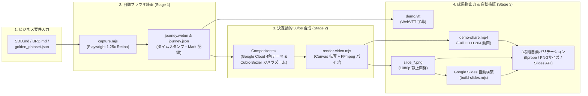

# Business-Driven Demo Video Generation Skill (`business-demo-video`) — 利用ガイド (README)

`business-demo-video` は、システム設計書（`SDD.md`）、ビジネス要件定義書（`BRD.md`）、またはゴールデン評価データセット（`golden_dataset.json`）から **ビジネス価値・定量 ROI・ガバナンス統制を実証するユーザージャーニーを抽出し、放送品質の Full HD (1920x1080, 30fps) 製品デモ動画（MP4）、同期字幕（WebVTT）、および Google スライド提案デッキを完全自動生成** するための Jetski / Gemini Agent スキルです。

---

## 1. 全体アーキテクチャと生成される成果物



### 自動生成される 4 つの成果物
1. **Full HD デモ動画 (`out/demo-share.mp4`)**: `1920x1080` / `30fps` / H.264 (`yuv420p`)。Google Cloud 4色ブランドバー、下部進行レール、BDD 要件バッジ付き字幕、重要エビデンス箇所への自動カメラズームを合成。
2. **同期 WebVTT 字幕ファイル (`out/demo.vtt`)**: 役員会議での無音再生やアクセシビリティに対応するタイムコード完全同期字幕。
3. **高解像度 1080p PNG 静止画 (`out/slide_01_*.png` 〜 `slide_N_*.png`)**: タイトル画面、Before/After 課題比較、ビジネス要件マップ、各要件の実証エビデンス画面、ROI 総括の高精細キャプチャ。
4. **Google Slides エグゼクティブ提案デッキ**: 16:9 ワイドスクリーン（`720 x 405 pt`）フルブリード画像配置 ＋ 全スライドへの BDD（`GIVEN` / `WHEN` / `THEN` & 定量 ROI）スピーカーノート自動挿入。

---

## 2. 利用するための前提条件 (Prerequisites)

本スキルを実行する環境（Cloudtop / gLinux またはローカル開発環境）において、以下のツールと認証が必要です。

### ① 必須ランタイム・システムツール
| ツール名 | 推奨バージョン | 用途・確認コマンド | インストールコマンド例 (gLinux / Debian) |
| :--- | :--- | :--- | :--- |
| **Node.js & npm** | `v20.x` 以上 | 録画・レンダリング・スライド構築スクリプトの実行 (`node -v`) | `nvm install 22` または標準パッケージ |
| **FFmpeg & FFprobe** | `v5.x` 以上 | H.264 MP4 パイプラインエンコードおよび動画ストリーム検証 (`ffmpeg -version`) | `sudo apt update && sudo apt install -y ffmpeg` |
| **Python 3** | `v3.10` 以上 | `journey.json` から WebVTT 字幕への変換 (`python3 --version`) | 標準プリインストール済 |
| **Playwright Chromium** | 最新版 | 1.25倍 Retina 自動ブラウザ操作と決定論的フレーム描画 | `npx playwright install chromium` |

### ② Google 社内 CLI ツール & 認証（Google Drive / Slides 自動連携用）
Cloudtop 上で Google Drive への動画アップロードおよび Google Slides 提案デッキ自動構築を行う場合、以下の CLI と認証が必要です。

1. **LOAS 認証 (`gcert`)**:
   ```bash
   gcert
   ```
2. **Google Drive CLI (`gdrive`)**:
   * バイナリパス: `/google/bin/releases/gemini-agents-gdrive/gdrive`
   * 用途: 生成した `demo-share.mp4` と `demo.vtt` の Google Drive アップロード・共有権限付与。
3. **Google Slides CLI (`gslides`)**:
   * バイナリパス: `/google/bin/releases/gemini-agents-gslides/gslides`
   * 用途: プレゼンテーションへの 1080p PNG フルブリード配置、スピーカーノート挿入、および API 要素バリデーション。

---

## 3. インストール・導入方法 (Installation)

### 方法 A：Jetski / Gemini Agent CLI のスキルとして導入する（推奨）

1. Google Drive 共有フォルダから `business-demo-video-skill.zip` をダウンロード（または `business-demo-video` フォルダをコピー）し、`~/.gemini/config/skills/` 配下に配置します：
   ```bash
   mkdir -p ~/.gemini/config/skills/
   unzip business-demo-video-skill.zip -d ~/.gemini/config/skills/
   ```
2. 以下のファイル構成になっていることを確認します：
   ```text
   ~/.gemini/config/skills/business-demo-video/
   ├── SKILL.md                          # AI エージェント向けスキル定義書
   ├── README.md                         # 本利用ガイド
   ├── scripts/
   │   └── json_to_vtt.py                # WebVTT 字幕生成スクリプト
   └── templates/
       ├── theme.ts                      # Google Cloud 4色テーマ定義
       ├── Compositor.tsx                # 純粋 React フレーム合成 & カメラズームエンジン
       ├── screens.mjs                   # Google Blue カスタムポインタ & 操作ヘルパー
       ├── record-template.mjs           # Stage 1: Playwright 自動録画スクリプト雛形
       ├── render-template.mjs           # Stage 2: 決定論的 30fps レンダラ雛形
       └── build-slides-template.mjs     # Stage 3: Google Slides 自動構築 & 3段階バリデーション雛形
   ```

---

## 4. 対象アプリケーションの選択・指定方法 (Selecting the Target Application)

デモ動画の録画対象となる Web アプリケーションは、以下の **3つの方法** のいずれかで自由に指定・選択できます。

### 方法 ①：AI エージェントへのプロンプトで URL やディレクトリを指定する（推奨）
チャットで `/business-demo-video` を呼び出す際、対象アプリの **URL** または **起動コマンド／ディレクトリ** を自然言語で伝えます。

* **パターン A：すでに起動中のローカルURL / Cloud Run URL を指定する場合**
  ```text
  /business-demo-video @[docs/SDD.md]
  対象アプリの URL は http://localhost:5173 です（または https://xxx.a.run.app）。
  ```
* **パターン B：リポジトリ内のソースコードから AI に自動起動＆録画させる場合**
  ```text
  /business-demo-video @[docs/SDD.md]
  リポジトリ内の frontend/ と backend/ を起動し、その画面を操作してデモ動画を作成してください。
  ```
  *(※ AI エージェントが自動で `package.json` や `Makefile` を解析してバックグラウンドで開発サーバーを起動し、ポート番号を特定して録画を実行します)*

### 方法 ②：環境変数 `APP_URL` で接続先を切り替える（CLI 実行時）
録画スクリプト（`capture.mjs` / `templates/record-template.mjs`）は、環境変数 **`APP_URL`** を優先して接続先ブラウザ URL を決定します（未指定時のデフォルトは `http://localhost:5173`）。
```bash
# ローカルの別ポート（例: 3000番や8080番）で動いているアプリを対象にする場合
APP_URL="http://localhost:3000" npm run capture

# ステージング環境や Cloud Run 上の本番アプリを対象にする場合
APP_URL="https://elevate-hr-agent-prod-xxx.a.run.app" node capture.mjs
```

### 方法 ③：既存の画面録画ファイル（`.webm` / `.mp4`）を持ち込む場合
対象アプリを手元で起動できない場合でも、あらかじめ録画しておいた動画ファイルがあれば、Stage 1（ブラウザ自動操作）をスキップして合成が可能です。
1. 録画ファイルを `video/public/clips/journey.webm`（または `journey.mp4`）として配置する。
2. `video/public/clips/journey.json`（または `src/script.ts`）にチャプターの秒数（タイムスタンプ）を記載する。
3. `npm run render` を実行すると、持ち込んだ動画に対して Google Cloud 4色テーマ・BDD 解説カード・カメラズーム・字幕・Google Slides 13枚が自動合成されます。

---

## 5. 利用の仕方 (How to Use) — 実行フロー詳細

### パターン 1：AI エージェント（Jetski）にワンコマンドで依頼する（最も簡単な方法）

チャット欄で `/business-demo-video` スキルを指定し、対象の設計書（`SDD.md` 等）をメンションして依頼します。

#### プロンプト例①（新規に動画・字幕・Google Slides を一括生成する場合）
```text
/business-demo-video @[docs/SDD.md] のビジネス要件（REQ-01〜04）に基づき、Full HD デモ動画、WebVTT 字幕、および Google Slides 提案デッキを一括生成してください。
```

#### プロンプト例②（既存の Google Slides プレゼンテーション ID を指定して流し込む場合）
```text
/business-demo-video @[docs/SDD.md]
生成した13枚のスライド静止画とGIVEN/WHEN/THENスピーカーノートを、Google Slides (ID: 1TleLU6_hrsdvccQ3xK9LC2cyiNH4el8Uqqs8Mw5VvxI) にフルブリード配置し、最後にバリデーションを実行してください。
```

---

### パターン 2：ターミナルから手動で各ステップを実行・カスタマイズする

プロジェクト内の `video/` ディレクトリにて、以下の npm スクリプトまたは Node コマンドで個別実行・再レンダリングが可能です。

#### Step 1: Web アプリの自動操作・録画 (`capture.mjs`)
アプリ（フロントエンド・バックエンド）を起動した状態で実行し、`public/clips/journey.webm` とタイムスタンプ情報 `journey.json` を記録します。
```bash
cd video
npm run capture
# または: node capture.mjs
```

#### Step 2: 決定論的 30fps 動画 & 1080p PNG 静止画レンダリング (`render-video.mjs`)
React コンポジタをバンドルし、フレーム落ちゼロ（30fps 決定論的シーク）で `out/demo-share.mp4` と `out/slide_*.png` を一括出力します。
```bash
npm run render
# または: node render-video.mjs
```

#### Step 3: WebVTT 字幕ファイルの生成 (`json_to_vtt.py`)
```bash
python3 scripts/json_to_vtt.py public/clips/journey.json out/demo.vtt
```

#### Step 4: Google Slides 提案デッキの自動構築 & 自動バリデーション (`build-slides.mjs`)
指定した Google Slides プレゼンテーションに対し、既存プレースホルダーの削除、16:9 フルブリード画像（`720x405pt`）の配置、GIVEN/WHEN/THEN スピーカーノートの挿入、および **構築後の API 自動バリデーション** を一括実行します。
```bash
npm run slides -- <PRESENTATION_ID>
# または: node build-slides.mjs <PRESENTATION_ID>
```

#### Step 5: バリデーションの単体実行 (`--validate-only`)
スライドの再アップロードを行わず、ローカル PNG の黒画面検査と Google Slides API 上での全スライドの実効サイズ・ノート格納状況のみを高速検査します。
```bash
npm run validate-slides -- <PRESENTATION_ID>
# または: node build-slides.mjs --validate-only <PRESENTATION_ID>
```

---

## 6. 自動バリデーション機構とよくあるトラブルシューティング

本スキルには、デモ動画やスライド作成で発生しがちな「白紙スライド」「黒画面キャプチャ」を 100% 防止・検知する安全機構が組み込まれています。

### Q1. Google Slides に挿入したスライドが「白紙」に見える場合
* **原因**: `gslides mutate insert-image-from-file` 実行後に個別に `move-element` や `resize-element` を呼び出すと、Google Slides API の座標変換（transform）の拡大率（`scaleX`, `scaleY`）が `190.5`（720x405pt）から `1.0`（約 `3.78pt x 2.12pt` の極小ドット）にリセットされ、画面左上の微小な点になってしまうためです。
* **本スキルの対策**:
  1. `insert-image-from-file` 実行時に直接 `--width 720 --height 405 --x 0 --y 0` を引数として渡し、1回の API 呼び出しでフルブリード配置を完了させます。
  2. 構築直後に `validateGoogleSlidesDeck()` が自動実行され、API 上の `size.width.magnitude * transform.scaleX / 12700` から実効サイズを計算し、**全スライドが `720.0 x 405.0 pt` であることを厳密に検証（Assert）**します。万一縮小されている場合は即座に `❌ FAIL` として検知します。

### Q2. 動画や PNG 静止画のブラウザ画面部分が「真っ黒」になる場合
* **原因**: Headless Chromium において `<video>` タグを直接 DOM スクリーンショット撮影すると、GPU ハードウェアデコードレイヤーがキャプチャから欠落する場合があるためです。
* **本スキルの対策**:
  1. **Master Video + 2D Canvas Frame Transfer**: オフスクリーンのシングルトン `<video>` 要素から `<canvas>` へ毎フレーム `ctx.drawImage()` でピクセル転写するアーキテクチャを採用し、ハードウェアレイヤー欠落を根本解決しています。
  2. **PNG ファイルサイズ閾値検査 (`validateLocalPngStills`)**: 1080p 画像が黒画面や白紙になった場合、PNG ファイルサイズが `5〜15 KB` に急減します。本スキルは全 PNG ファイルが `30 KB 以上` であることをアップロード前に自動検査します。
