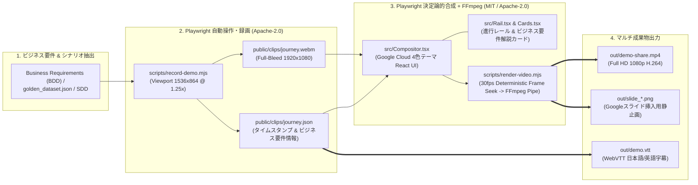

# Business-Driven Demo Video Generation Skill (`business-demo-video`)

このスキルは、**BDD（Business-Driven Development：ビジネス要件駆動開発）におけるビジネス要件定義**、ゴールデン評価データセット（`golden_dataset.json`）、またはシステム設計書（`SDD.md`）から **ビジネス価値を実証するユーザージャーニーを抽出し、Playwright 自動ブラウザ録画と決定論的動画合成エンジン（Playwright Frame Compositor + FFmpeg）を組み合わせて、エグゼクティブおよび事業部門へ提示可能な放送品質の Full HD (1920x1080, 30fps) デモ動画を完全自動生成** するための標準ワークフローを提供します。

> **【重要】本スキルにおける BDD の定義（Business Requirements First）**
> 本スキルにおける **BDD** は、単なる UI の機能動作や技術的な振る舞い（Behavior）のテストではなく、**「Business Requirements（ビジネス要件・業務課題の解決・定量的なビジネス価値の証明）」** を意味します。動画のすべてのチャプター・字幕・解説カードは、「どのボタンを押したか」ではなく **「どのビジネス要件（業務効率化・リスク統制・SLA達成・ROI）をいかに充足したか」** を軸に構成します。

---

## 1. アーキテクチャ概要 (Pipeline Architecture)



---

## 2. 6つの黄金設計原則 (Golden Rules)

デモ動画の品質・可読性・再現性、および **ビジネス訴求力** を担保するため、以下の原則を必ず遵守してください。

### Rule 1: Full-Bleed 1080p 録画と 1.25倍 Retina スケーリング
* **課題**: `1920x1080` 等倍（scale 1.0）で Web アプリを録画すると、UI のフォントが小さすぎて役員プレゼン会場やスライド埋め込み時に文字が判読できなくなる。またアスペクト比が合わないと上下左右に黒帯（レターボックス）が発生する。
* **解決策**:
  * Playwright 起動時に `--force-device-scale-factor=1.25` を指定し、Viewport を **`1536 x 864`**（`1536 * 1.25 = 1920`, `864 * 1.25 = 1080`）に設定する。
  * `recordVideo: { dir: 'public/clips', size: { width: 1920, height: 1080 } }` を指定する。
  * Compositor 側の `<video>` 要素で `style={{ width: 1920, height: 1080, objectFit: 'cover' }}` として Full-Bleed（余白ゼロ）で描画する。

### Rule 2: タイムスタンプ連動メタデータ (`journey.json`) の自動記録とビジネス要件マッピング
* **課題**: 録画後に動画編集ソフトや手動のフレーム指定で字幕・チャプターを切り替えると、UI 操作と字幕のタイミングがズレやすく、シナリオ変更のたびに手直しが必要になる。
* **解決策**:
  * `record-demo.mjs` 内で録画開始時刻 `t0 = Date.now()` を記録し、各 **ビジネス要件チャプター（Business Requirement #1〜N）** や業務フェーズ（`GIVEN: 業務背景・課題` / `WHEN: AI業務介入` / `THEN: ビジネス成果・統制価値`）の開始・終了秒数を計算して `public/clips/journey.json` に自動出力する。
  * Compositor コンポーネントは `journey.json` を読み込み、フレーム数（`Math.round(seconds * fps)`）に自動変換して字幕オーバーレイ・ビジネス要件解説カード・プログレスバーを描画する。

### Rule 3: Google Cloud 4色ブランドテーマとビジネス要件進行レール (`Rail.tsx`)
* **ビジネス要件に応じたカラーパレットの意味付け**:
  * **Google Blue (`#4285F4`)**: Primary Business Workflow / 業務効率化・標準化要件（Scene 1）
  * **Google Green (`#34A853`)**: Business Value & SLA Fulfillment / ROI達成・自動完結・補償トランザクション（Scene 2）
  * **Google Red (`#EA4335`)**: Risk & Governance Control / セキュリティ・コンプライアンス統制・ガードレール要件（Scene 3）
  * **Google Yellow (`#FBBC04`)**: Exception & Human-in-the-Loop / 異常検知・有人エスカレーション・承認要件（Scene 4）
  * **Dark Ink (`#202124`)**: Background / Executive Typography
* **UI コンポーネント**:
  * **Top Gradient Bar**: 画面最上部（高さ `6px`）に 4色グラデーションバーを常時表示。
  * **Bottom Progress Rail**: 画面最下部に全ビジネス要件ジャーニーの現在位置と進捗率を示す 4色プログレスレールを配置。
  * **Floating Caption Banner**: 画面下部（レールの直上）に `rgba(32, 33, 36, 0.92)` の半透明ダークピル型バナーを配置し、現在実証中のビジネス要件と定量インパクト（例：「`【Business Req #1: 規程照会・申請の即時化】複雑な就業規則の横断検索から申請起票までをワンストップで自動完結（処理リードタイム90%削減）`」等）を表示。単なる技術処理の実況（「RAG検索を実行中...」）に留めないこと。

### Rule 4: Playwright 決定論的フレームシーク (`render-template.mjs`) によるフレーム落ちゼロ合成
* ブラウザのリアルタイム再生を画面キャプチャすると、CPU/GPU 負荷によってフレーム落ち（カクつき）や音声/字幕ズレが発生する。
* これを防ぐため、`templates/render-template.mjs` では **Playwright の決定論的フレームシーク（Deterministic Frame-by-Frame Stepping）** を採用する：
  1. 1フレーム（`1 / 30秒`）ずつ `window.seekToFrame(frame)` を呼び出し、内部の `<video>` 要素の `currentTime` シーク完了（`seeked` イベント）と React/DOM の描画更新を厳密に待機する。
  2. 描画完了後のフレームバッファを `ffmpeg -f image2pipe -framerate 30 -i - -c:v libx264 -pix_fmt yuv420p` の標準入力パイプへ直接流し込むことで、**マシン性能に一切依存しない 100% 完全な 30fps MP4 動画**を生成する。

### Rule 5: マルチ成果物の同時生成（MP4 + WebVTT + Googleスライド用PNG静止画）
* 動画ファイル単体で終わらせず、必ず以下の **3点セット** を生成する：
  1. **Full HD MP4 (`H.264`, `yuv420p`, `30fps`)**: Google Drive (`gdrive mutate upload`) にアップロードして共有リンクを発行可能にする。
  2. **WebVTT 字幕ファイル (`.vtt`)**: `scripts/json_to_vtt.py` で生成し、役員会議での無音再生やアクセシビリティに対応する。
  3. **高解像度チャプター静止画 (`slide_*.png`)**: `render-template.mjs` のフレームループ内で、タイトル画面・ビジネス要件マップ・各要件実証シーンの決定的な瞬間（エビデンス画面）のフレーム番号を指定し、無劣化 1080p PNG として同時出力する。出力した画像は `gslides` スキル（`insert-image-from-file`）で提案書スライドへ直接挿入する。

### Rule 6: Mark 駆動のカメラズーム補間 (`focus: Region`) とカスタムポインタ演出 (`screens.mjs`)
* **Mark 記録 (`mark(name)`)**: `capture.mjs` 内で各マイクロ操作（業務依頼の送信、規程根拠バッジの提示、監査証跡ドロワーの展開など）ごとに `mark('step_name')` を記録し、`journey.json` の `marks` 辞書へミリ秒単位で保存する。
* **宣言的カメラズーム (`Compositor.tsx`)**: `Beat` 定義で `{ mark: 'step_name', reqId: 'REQ-01', focus: [x, y, w, h], push: 1.35, caption: '...' }` を指定することで、録画やり直し不要でビジネス要件充足のエビデンス領域（監査ログ・承認ステータス・金額計算結果など）へ滑らかな Cubic-Bezier ズーム＆パンを行う。
* **Google Blue カスタムポインタ (`screens.mjs`)**: `installPointer(page)` により `28px` の Google Blue ポインタ (`#1A73E8`) を描画し、`clickWithPointer`（クリック時に Google Green `#34A853` へパルス変化）と `typeWithPointer` によって視認性を極大化する。

---

## 3. 標準ディレクトリ構成 (Project Structure)

対象リポジトリのルート直下に `video/` ディレクトリを作成し、以下の構成で実装します。

```text
video/
├── package.json              # Playwright, React & Vite の依存定義
├── tsconfig.json
├── vite.config.ts            # Compositor プレビュー & ローカル配信サーバー設定
├── capture.mjs               # Stage 1: Playwright 自動ブラウザ操作 & journey.webm / journey.json 生成
├── render-video.mjs          # Stage 2: Playwright 決定論的 30fps レンダラ -> FFmpeg パイプ & slide_*.png 出力
├── chapters.mjs              # ビジネス要件 (Business Req 1..N) ごとの mark() 記録と DOM 操作
├── screens.mjs               # Google Blue カスタムポインタ & クリック/タイピング制御ヘルパー
├── public/
│   └── clips/
│       ├── journey.webm      # Playwright 録画データ (1920x1080 @ 1.25x scale)
│       └── journey.json      # タイムスタンプ・ビジネス要件チャプター・marks 定義メタデータ
├── src/
│   ├── main.tsx              # React エントリポイント + window.seekToFrame(frame) グローバルフック登録
│   ├── Compositor.tsx        # メインタイムライン合成 (Executive Title -> Req Map -> Scenes -> Business Impact)
│   ├── script.ts             # Beat 定義 (mark, reqId, caption, focus Region, accentColor)
│   ├── theme.ts              # Google Cloud 4色テーマ定義 (テンプレート参照)
│   ├── Slides.tsx            # エグゼクティブタイトル・ビジネス要件マップ・ROIサマリースライド
│   ├── Cards.tsx             # 各ビジネス要件シーン導入用の GIVEN(業務課題)/WHEN(AI遂行)/THEN(ビジネス価値) 解説カード
│   └── Rail.tsx              # Google 4色グラデーションバー & 下部ビジネス要件進行レール
└── out/
    ├── demo-share.mp4        # 最終出力 Full HD MP4 動画 (H.264 / yuv420p)
    ├── demo.vtt              # 最終出力 WebVTT 字幕トラック
    └── slide_*.png           # Google スライド挿入用 1080p 静止画群
```

---

## 4. 実装手順 (Step-by-Step Workflow)

### Step 1: ビジネス要件 (Business Requirements) の抽出と構成設計
1. リポジトリ内の `docs/SDD.md`、`README.md`、または `tests/eval/datasets/golden_dataset.json` を読み込み、顧客が解決すべき **中核ビジネス要件（Core Business Requirements）** を特定する。
2. デモで実証すべき **3〜5個の代表的なビジネス要件充足ジャーニー（Business-Driven User Journeys）** を選定する：
   * **要件カテゴリ①：業務生産性・即時応答要件（Blue）** — 例：複雑な社内規程・マニュアルの横断照会と基幹システムへのワンストップ自動起票による業務リードタイムの劇的短縮。
   * **要件カテゴリ②：業務継続性・トランザクション整合性要件（Green）** — 例：複数システム連携時のデータ整合性担保と、異常発生時の自動補償ロールバック（Saga パターン）による業務無停止運用。
   * **要件カテゴリ③：リスク管理・ガバナンス統制要件（Red）** — 例：機密情報（PII）マスキング、職務分掌（SoD）に基づく権限外操作の自動ブロック、コンプライアンス違反のリアルタイム遮断と監査証跡の保全。
   * **要件カテゴリ④：例外管理・Human-in-the-Loop 要件（Yellow）** — 例：AI の判断閾値を超える重要案件における、判断根拠・コンテキスト一式を添えた上長・専門部署へのシームレスなエスカレーションと承認ワークフロー。
3. 各ビジネス要件について、技術的なテスト仕様ではなく **ビジネス価値フレームワーク** で `GIVEN` / `WHEN` / `THEN` を定義する：
   * **`GIVEN` (Business Context & Pain Point / 業務背景・現場の課題)**: 業務部門や経営層が直面している業務上のボトルネック、手作業コスト、人的ミス、またはコンプライアンス上のリスク。
   * **`WHEN` (Business Action & AI Execution / 業務委譲・AIの自律遂行)**: 現場担当者が自然言語で業務目的を委譲し、AI エージェントが複数システム・規定を横断して自律的に業務を遂行するプロセス。
   * **`THEN` (Business Outcome & Governance Value / ビジネス成果・統制価値)**: 達成された定量的・定性的なビジネス価値（例：「処理時間 90% 削減」「規程準拠率 100%」「監査ログ完全自動記録」）および SLA の充足結果。

### Step 2: `video/` プロジェクトの初期化とテンプレート配置
1. `video/` ディレクトリを作成し、`package.json` に `playwright`, `react`, `react-dom`, `vite` を導入する。
2. 本スキルのテンプレートをコピーしてベースを構築する：
   * テーマ定義: [templates/theme.ts](file:///usr/local/google/home/makotow/.gemini/config/skills/business-demo-video/templates/theme.ts)
   * 純粋 React カメラズーム＆合成コンポーネント: [templates/Compositor.tsx](file:///usr/local/google/home/makotow/.gemini/config/skills/business-demo-video/templates/Compositor.tsx)
   * カスタムポインタ＆操作ヘルパー: [templates/screens.mjs](file:///usr/local/google/home/makotow/.gemini/config/skills/business-demo-video/templates/screens.mjs)
   * 録画スクリプト雛形: [templates/record-template.mjs](file:///usr/local/google/home/makotow/.gemini/config/skills/business-demo-video/templates/record-template.mjs)
   * 決定論的フレームレンダラ＆PNG出力スクリプト: [templates/render-template.mjs](file:///usr/local/google/home/makotow/.gemini/config/skills/business-demo-video/templates/render-template.mjs)
   * Google スライド自動構築＆バリデーション雛形: [templates/build-slides-template.mjs](file:///usr/local/google/home/makotow/.gemini/config/skills/business-demo-video/templates/build-slides-template.mjs)
   * WebVTT 生成スクリプト: [scripts/json_to_vtt.py](file:///usr/local/google/home/makotow/.gemini/config/skills/business-demo-video/scripts/json_to_vtt.py)

### Step 3: Playwright 自動操作・録画の実行 (`capture.mjs` / `record-demo.mjs`)
1. バックエンド・フロントエンドサーバーを起動し、正常に応答することを確認する。
2. `record-demo.mjs` に各ビジネス要件シナリオの DOM 操作（業務依頼入力、AI推論・ツール実行待機、根拠ドキュメント・監査ドロワーの開閉など）を記述する。
   * `recorder.logChapter(...)` には要件 ID（`REQ-01` 等）、ビジネス要件タイトル、業務課題（`GIVEN`）、AI遂行内容（`WHEN`）、ビジネス成果・ROI（`THEN`）を記録する。
   * **視覚的ポインター演出**: クリック操作の直前に画面上に青い波紋インジケーター（Visual Click Ripple）または Google Blue カスタムポインタを表示し、どの業務エビデンスを確認しているかを視聴者が一目で把握できるようにする。
3. `node scripts/record-demo.mjs` を実行し、`public/clips/journey.webm` と `public/clips/journey.json` が生成されることを検証する。
   * もし出力された WebM のファイル名がハッシュ値になっている場合は、`journey.webm` にリネームする。

### Step 4: Playwright Deterministic Compositor + FFmpeg による MP4 / 静止画一括生成
1. `src/Compositor.tsx` にて以下の構成（Executive Sandwich Pattern）でタイムラインを組む：
   * **Executive Title Slide (3.5秒)**: ソリューション名、対象事業領域、解決する経営・業務アジェンダ（Business Value Proposition）。
   * **Business Requirements & Architecture Map Slide (4.0秒)**: システム全体像と、本動画で実証する **ビジネス要件一覧（REQ-01〜04）および目標 KPI / SLA** の対応マップ。
   * **For each Business Requirement Scene (Scene 1..N)**:
     * **Business Requirement Intro Card (3.0秒)**: Dark Ink 背景に要件 ID（`REQ-01` 等）と `GIVEN`（業務課題）/ `WHEN`（AI業務遂行）/ `THEN`（達成されるビジネス成果・ROI）を明示したチャプターカード。
     * **Live Browser Shot (`journey.json` の該当区間)**: Full-Bleed ブラウザ映像 + ビジネス要件充足を示す下部フローティング字幕 + 4色進行レール。重要なエビデンス箇所（監査証跡や計算結果）では `focus` によるカメラズームを適用。
   * **Closing Business Impact Slide (4.0秒)**: **Business Requirements Fulfillment（全ビジネス要件 100% 充足）**、Golden Evaluation 適合スコア、および導入による定量的 ROI / ガバナンス効果の総括。
2. ローカルで Compositor サーバー（Vite 等）を起動した状態で、`render-video.mjs` を実行し、**Full HD MP4 動画（`out/demo-share.mp4`）と Google スライド挿入用 PNG 静止画群（`out/slide_*.png`）を一括レンダリング**する：
   ```bash
   node render-video.mjs
   ```
3. WebVTT 字幕ファイルを生成する：
   ```bash
   python3 scripts/json_to_vtt.py public/clips/journey.json out/demo.vtt
   ```

### Step 5: Google Drive アップロード & Google スライド (`gslides`) 連携
1. 生成した `out/demo-share.mp4` を `gdrive` スキルで Google Drive にアップロードし、組織内閲覧権限を付与する：
   ```bash
   /google/bin/releases/gemini-agents-gdrive/gdrive mutate upload out/demo-share.mp4 --json
   /google/bin/releases/gemini-agents-gdrive/gdrive mutate share <FILE_ID> --email <USER_EMAIL> --role writer --notify=false
   ```
2. `gslides` スキル（`build-slides.mjs`）を使用して、顧客提案用プレゼンテーションの全スライドへ `out/slide_*.png` のキャプチャ画像とスピーカーノート（GIVEN/WHEN/THEN）を配置する。
   * **【重要：画像サイズ・座標の直接指定ルール】**: `gslides mutate insert-image-from-file` 実行後に個別に `move-element` や `resize-element` を呼び出すと、Google Slides API の transform スケール値（`scaleX`, `scaleY`）が `190.5`（720x405pt）から `1.0`（`3.78pt x 2.12pt` の極小ドット）へリセットされ、スライドが白紙に見える事象が発生する。必ず `insert-image-from-file` の引数（`--width 720 --height 405 --x 0 --y 0`）で挿入と同時にフルブリードサイズを指定すること。

### Step 6: 成果物・Google スライドの最終バリデーション（Mandatory Post-Build Validation）
**スライドが白紙（ブランク）になっていたり、想定外のレイアウト崩れ・動画デコード漏れが発生していないかを、完了報告前に必ず以下の3段階でプログラム検証（Assert）し、エビデンス表を出力すること：**

1. **Stage A: MP4 動画ストリーム検証 (`ffprobe`)**:
   * `ffprobe` を実行し、コーデックが `h264`、解像度が `1920x1080`、フレームレートが `30/1`、総フレーム数がタイムライン定義と完全一致していることを確認する。
2. **Stage B: ローカル PNG 静止画のブランク・黒画面検査 (`validateLocalPngStills`)**:
   * 全スライド分の `out/slide_*.png` ファイルが存在し、**ファイルサイズが最小閾値（`30 KB` 以上）を満たしていること**を検査する（`<video>` のデコード未完了による黒画面や白紙の 1080p PNG はファイルサイズが `5〜15 KB` に落ち込むため、サイズ検査で 100% 検知可能）。
   * さらに、UI キャプチャを含む主要エビデンス静止画（`slide_05`, `slide_07` 等）を `view_file` で視覚的にも確認する。
3. **Stage C: Google スライド API 要素・実効サイズ検証 (`validateGoogleSlidesDeck`)**:
   * スライド構築完了後、必ず `gslides readonly list-slides <PRES_ID> --json` を取得し、全スライド（`Slide 1` 〜 `Slide N`）について以下の4項目を自動検証する（[templates/build-slides-template.mjs](file:///usr/local/google/home/makotow/.gemini/config/skills/business-demo-video/templates/build-slides-template.mjs) 参照）：
     1. **画像要素の存在 (`hasImage === true`)**: スライド上に `image` 要素が存在すること。
     2. **フルブリード実効サイズの検証 (`Rendered Size == 720.0 x 405.0 pt`)**: `size.width.magnitude * transform.scaleX / 12700` で算出される実効幅・高さが **`widthPt >= 700` かつ `heightPt >= 390`** であること（`scaleX: 1.0` 等に縮小・白紙化していないことの厳密な証明）。
     3. **不要な初期プレースホルダーの残存ゼロ (`elements.length === 1`)**: 「クリックしてタイトルを追加」等のデフォルトテキスト枠が完全に削除されていること。
     4. **スピーカーノートの格納確認 (`notesLen >= 20`)**: `slideProperties.notesPage` に BDD（GIVEN/WHEN/THEN）解説テキストが確実に書き込まれていること。
   * 検証結果テーブル（`Slide # | Slide ID | Elements | Rendered Size (pt) | Notes Len | Status`）をコンソールおよび最終報告に出力し、全スライドが `✅ PASS` であることを確認してからタスク完了とする。


