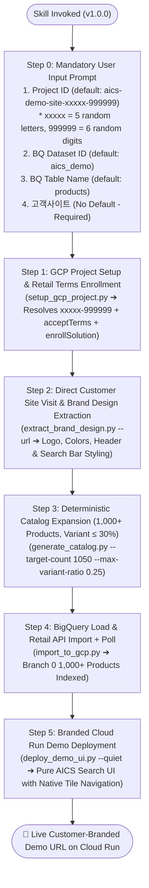

# AI Commerce Search (AICS) Custom Demo Data & UI Creator Skill (`create-aics-demo-data`) — Version 1.0.0

This skill guides the agent through creating a complete, customer-tailored **Google Cloud AI Commerce Search (Vertex AI Search for Commerce / Retail API v2)** demonstration environment from scratch.

> [!IMPORTANT]
> **Mandatory Initial Input Prompt (Step 0) & Collision-Free Project ID (`aics-demo-site-xxxxx-999999`)**:
> 1. **When this skill is invoked, you MUST FIRST prompt / confirm the 4 core configuration inputs from the user before running any setup or generation scripts**:
>    - **1. Project ID**: `(기본값: aics-demo-site-xxxxx-999999 — 중복 방지를 위해 xxxxx는 랜덤 영문 소문자 5자리, 999999는 랜덤 숫자 6자리로 자동 생성됨. 예: aics-demo-site-cyewl-431370)`
>    - **2. BigQuery Dataset ID**: `(기본값: aics_demo)`
>    - **3. BigQuery Table Name**: `(기본값: products)`
>    - **4. 고객사이트 (Customer Website URL)**: `(기본값 없음 — 필수 입력, 예: https://www.edion.com/)`
> 2. **Language Selection (`ja-JP` Default)**:
>    - Defaults to **Japanese (`ja-JP`, currency `JPY`)** unless the user specifies another ISO language code (`en-US`, `ko-KR`, etc.).
> 3. **Direct Customer Site Design Extraction**:
>    - Directly visits `고객사이트` to inspect live DOM/CSS and header screenshot, extracting the official logo, corporate primary/accent colors, header background, and search box border-radius.

---

## Architecture & Execution Pipeline (v1.0.0)



---

## Step-by-Step Agent Instructions

When the user invokes this skill, follow these steps strictly in order:

### Step 0: Collect & Confirm Initial Parameters (Mandatory First Action)

Before executing any commands, present or confirm the following 4 parameters with the user (using `ask_question` or a clear structured confirmation prompt):

| 번호 | 항목명 (Parameter) | 기본값 패턴 / 생성 규칙 (Default Value) | 설명 |
| :---: | :--- | :--- | :--- |
| **1** | **Project ID** | `aics-demo-site-xxxxx-999999` | 배포할 대상 GCP 프로젝트 ID. 글로벌 중복 방지를 위해 **`xxxxx` (랜덤 알파벳 소문자 5자리)** + **`999999` (랜덤 숫자 6자리)** 조합으로 자동 생성 (총 27자, 예: `aics-demo-site-cyewl-431370`) |
| **2** | **BigQuery Dataset ID** | `aics_demo` | 상품 카탈로그가 저장될 BigQuery 데이터셋 ID |
| **3** | **BigQuery Table Name** | `products` | 상품 카탈로그가 저장될 BigQuery 테이블 이름 |
| **4** | **고객사이트 (Customer Site URL)** | **기본값 없음 (필수 입력)** | 디자인/로고/컬러 및 상품 도메인을 추출할 실제 고객사 웹사이트 주소 |

> [!TIP]
> **Project ID 생성 규칙 상세 (`aics-demo-site-xxxxx-999999`)**:
> - GCP Project ID는 전 세계적으로 고유(Globally Unique)해야 하며 최대 30자 제한이 있습니다.
> - `aics-demo-site-` (15자) + `xxxxx` (랜덤 영문 소문자 5자리) + `-` (1자) + `999999` (랜덤 숫자 6자리) = **정확히 27자**로 생성되어 GCP 명명 규칙(6~30자)을 100% 준수하면서 프로젝트 ID 충돌을 원천 차단합니다.
> - 사용자가 기본값 진행을 요청하거나 `aics-demo-site-xxxxx-999999` 패턴을 그대로 전달하면, `setup_gcp_project.py`가 실행 시점에 즉시 난수를 치환하여(예: `aics-demo-site-kqzmp-482910`) 프로젝트를 생성합니다.

---

### Step 1: GCP Project Setup & Programmatic Retail API Enrollment

Run [`scripts/setup_gcp_project.py`](scripts/setup_gcp_project.py) to generate/verify the target GCP project (`Project ID`), link billing, enable required APIs (`retail.googleapis.com`, `bigquery.googleapis.com`, `run.googleapis.com`, `cloudbuild.googleapis.com`, `orgpolicy.googleapis.com`), configure Compute Service Account IAM permissions, set `constraints/iam.allowedPolicyMemberDomains` to `allowAll: true`, and **programmatically accept Retail API Terms & enroll Retail Search (`SOLUTION_TYPE_SEARCH`) via `v2alpha`**:

```bash
# If --project-id is omitted or passed as "aics-demo-site-xxxxx-999999",
# setup_gcp_project.py automatically generates 5 random letters + 6 random digits:
python3 /usr/local/google/home/minsoojun/work/myskills/create_aics_demo_data/scripts/setup_gcp_project.py \
  --project-id "aics-demo-site-xxxxx-999999" \
  --brand-name "<BRAND_NAME>"
```

Capture the printed `ACTIVE_PROJECT_ID=<resolved-project-id>` from the script output and use that resolved Project ID for Steps 4 and 5.

---

### Step 2: Direct Customer Website Visit & Live Brand Design Extraction (`고객사이트 방문 및 디자인 반영`)

> [!IMPORTANT]
> **Direct Customer Site Visit for High-Craft Brand Fidelity**:
> To ensure the demo site looks like an authentic, high-craft application tailored to the customer, **you MUST directly visit the customer website (`고객사이트`)** to extract its live visual identity, logo URL, header background color, primary corporate color, accent/price highlight color, search bar border radius, and top navigation categories.

1. **Run [`scripts/extract_brand_design.py`](scripts/extract_brand_design.py)** against the customer URL:
   ```bash
   python3 /usr/local/google/home/minsoojun/work/myskills/create_aics_demo_data/scripts/extract_brand_design.py \
     --url "<CUSTOMER_SITE_URL>" \
     --output "/tmp/brand_design_profile.json" \
     --screenshot "/tmp/customer_header_screenshot.png"
   ```
2. **Visually Inspect the Header Screenshot (`view_file` on `/tmp/customer_header_screenshot.png`)**:
   - Inspect `/tmp/customer_header_screenshot.png` using `view_file` to verify the customer's actual logo appearance, header background color (`header_bg`), primary brand color (`primary_color`), search box shape (`search_radius`), and price text color (`price_color`).
   - Fine-tune `/tmp/brand_design_profile.json` if needed so that contrast and brand colors match the live customer site 100%.
3. **Curate & Visually Verify Real Product Images**:
   - Search Wikimedia Commons / Google Search for real product images matching the customer's signature products (`primary_seeds`), download them into `template/static/img/products/`, and visually inspect every image via `view_file` so that 100% of product cards display accurate, real product photos matching their titles.
4. **Synthesize `blueprint.json`**:
   - Create `/tmp/<customer>_blueprint.json` incorporating the extracted `brand_profile` (`logo_url`, `primary_color`, `secondary_color`, `accent_color`, `header_bg`, `badge_text_color`, `price_color`, `search_radius`, `language_code: "ja-JP"` default) and 16+ real signature `primary_seeds`.

---

### Step 3: Deterministic Catalog Expansion (`1,000+ Products`, `Variant Ratio ≤ 30%`)

Run [`scripts/generate_catalog.py`](scripts/generate_catalog.py) with `--target-count 1050` and `--max-variant-ratio 0.25` (strictly enforcing **Variant ratio $\le 30\%$**) and `--design-profile /tmp/brand_design_profile.json`:

```bash
python3 /usr/local/google/home/minsoojun/work/myskills/create_aics_demo_data/scripts/generate_catalog.py \
  --blueprint "/tmp/<customer>_blueprint.json" \
  --design-profile "/tmp/brand_design_profile.json" \
  --language "ja-JP" \
  --output-catalog "/tmp/<customer>_products.jsonl" \
  --output-brand-config "/tmp/<customer>_brand_config.json" \
  --target-count 1050 \
  --max-variant-ratio 0.25
```

---

### Step 4: BigQuery Ingestion & Retail API Import (with Completion Polling)

Run [`scripts/import_to_gcp.py`](scripts/import_to_gcp.py) using the resolved `Project ID` (`ACTIVE_PROJECT_ID`), `BigQuery Dataset ID` (default: `aics_demo`), and `BigQuery Table Name` (default: `products`). This script loads BigQuery, configures `attributesConfig`, triggers `products:import` into Branch 0 (`default_catalog/branches/0`), and **polls until `done: true` with `successCount >= 1000`**:

```bash
python3 /usr/local/google/home/minsoojun/work/myskills/create_aics_demo_data/scripts/import_to_gcp.py \
  --project-id "<ACTIVE_PROJECT_ID>" \
  --dataset "<BQ_DATASET_ID>" \
  --table "<BQ_TABLE_NAME>" \
  --catalog-file "/tmp/<customer>_products.jsonl"
```

---

### Step 5: Deploy Pure-AICS Customer-Branded Demo UI to Cloud Run

Run [`scripts/deploy_demo_ui.py`](scripts/deploy_demo_ui.py) to deploy the FastAPI + Vanilla JS application ([`template/`](template/)) to Google Cloud Run (`--quiet`). The UI automatically applies the customer's extracted logo (`logo_url`), header background (`header_bg`), brand colors, enlarged search bar, and native **AI Commerce Search (`RETAIL_API` v2) Tile Navigation (`tileNavigationSpec`)**:

```bash
python3 /usr/local/google/home/minsoojun/work/myskills/create_aics_demo_data/scripts/deploy_demo_ui.py \
  --project-id "<ACTIVE_PROJECT_ID>" \
  --service-name "<customer-slug>-aics-demo" \
  --region "asia-northeast1" \
  --dataset "<BQ_DATASET_ID>" \
  --table "<BQ_TABLE_NAME>" \
  --catalog-file "/tmp/<customer>_products.jsonl" \
  --brand-config "/tmp/<customer>_brand_config.json"
```

---

## Version History & Release Notes

- **Version 1.0.0 (Official Frozen Release — 2026-09-17)**:
  - **Collision-Free Project ID Format (`aics-demo-site-xxxxx-999999`)**: Updated default Project ID generator in `SKILL.md` and `scripts/setup_gcp_project.py` to generate 5 random lowercase letters (`xxxxx`) + 6 random digits (`999999`), resulting in a 27-character globally unique GCP Project ID (e.g., `aics-demo-site-cyewl-431370`).
  - **Step 0 Interactive Prompt**: Standardized 4 initial inputs (`Project ID`, `BigQuery Dataset ID: aics_demo`, `BigQuery Table Name: products`, `고객사이트 URL`).
  - **Live Brand Extraction (`extract_brand_design.py`)**: Direct Playwright visit to extract real customer header logo, corporate palette, and search bar styling.
  - **1,000+ Catalog & Variant Governance**: Strictly enforces $\ge 1,000$ products with Variant ratio $\le 30\%$ (`0.25` default) and real verified product photos.
  - **Programmatic Terms & Cloud Run Deployment**: Zero-prompt `v2alpha` Retail API terms acceptance, solution enrollment, and `--quiet` Cloud Run deployment with native `tileNavigationSpec`.
